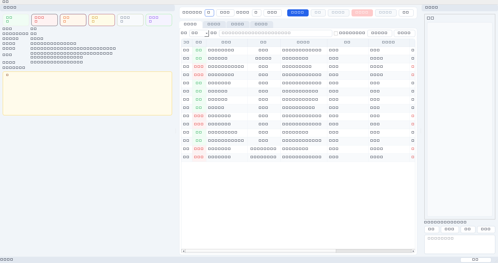
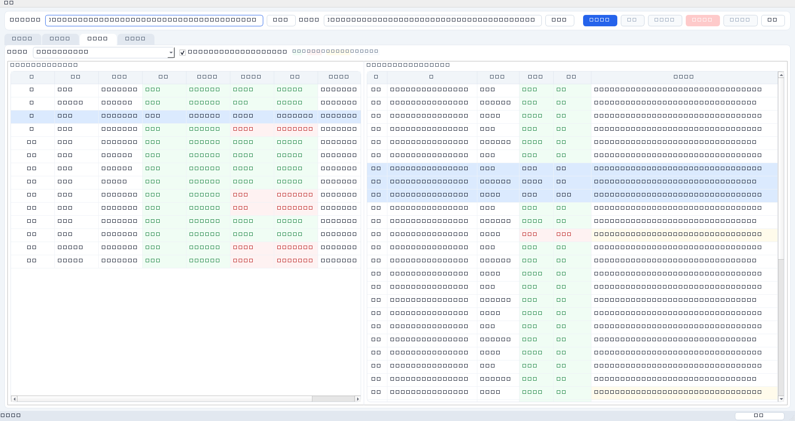
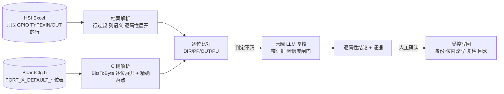

# GenBoardConfig

按 GPIO 分配 Excel 核对并修正板级配置文件（`.c` / `.h`）的 Windows 桌面工具。
核对与判定由大模型（云端 API）完成，**文件写回由确定性代码执行**（LLM 只输出结构化结论，不直接改文件）。



---

## 1. 真实场景（NTK + RTK 双系列已支持）

界面在「设置 → 项目系列」可切换 **NTK / RTK**（默认按板级配置文件特征自动识别）。

### 1.1 NTK 系列（Novatek，端口位表）

- `samples/NTK/05_Hardware_Software_Interface(HSI)-....xlsx` → 关键 Sheet **HSI**（表头第 5 行）
- `samples/NTK/BoardCfg.h` → 核对目标是**端口位表**：

```c
#define PORT_C_DEFAULT_OUT     BitsToByte(HIGH, HIGH, HIGH, HIGH, HIGH,  LOW,  LOW, HIGH)  // 上电电平 bit7..bit0
#define PORT_C_DEFAULT_DIR     BitsToByte( IN,  IN,  IN,  IN, IN, OUT, OUT,  IN)             // 方向
#define PORT_C_DEFAULT_PP      BitsToByte( LOW,  LOW,  LOW,  LOW, LOW, HIGH, HIGH,  LOW)      // 1=推挽 0=开漏
#define PORT_C_DEFAULT_PU      BitsToByte( LOW,  LOW,  LOW,  LOW,  LOW,  LOW,  LOW,  LOW)      // 上拉
```

| 板级配置宏 | Excel 列 | 属性 |
|---|---|---|
| `PORT_X_DEFAULT_DIR[bit]` | **G 列**「GPIO  TYPE(输入输出类别)」 | 方向 |
| `PORT_X_DEFAULT_PP[bit]` | **H 列**「Output PIN 设定类型」 | 输出类型 |
| `PORT_X_DEFAULT_OUT[bit]` | **I 列**「Power On」 | 上电电平 |
| `PORT_X_DEFAULT_PU[bit]` | — | **暂时忽略** |

### 1.2 RTK 系列（Realtek RL6829，引脚复用表）

- `samples/RTK/Hardware_Software_Interface_PHL 27M2N5500X_20250611.XLSX` → 同样是 **HSI** Sheet（127 行）
- `samples/RTK/TPV_21_715GF225_2H1DP_EDP_PINSHARE.h` → 核对目标是**引脚复用**：

```c
// Function : HDMI2_HPD            ← 原理图网络名（对应 Excel F 列）
#define _PIN_C1                  (_PIN_C1_GPO_OD)   ← ★ 实际生效的复用功能
```

RTK 核的是「引脚被复用成了哪个功能、什么电气属性」，分五层：
L0 行筛选（G 列非空 → 58 行）→ L1 电气属性（`GPI`/`GPO_PP`/`GPO_OD` 与 G/H 列比对）
→ L2 功能名（专用功能名与 Excel (App) 名不一致 → **交大模型**判定等效）
→ L3 存在性（`.h` 无该网络名 → **不核对**）→ L4 噪声（模板占位符/`(SPI)` 等 → 跳过）。

实测（58 行）：**25 一致 / 6 不一致 / 2 歧义（待模型或人工）/ 25 不适用**。
6 处不一致可自动改写，只替换 `#define` 右值后缀，排版不变；复检「修复 12 / 剩余 0 / 新增 0」。

完整规则见 **[docs/comparison_rules.md](docs/comparison_rules.md)** 与 **[docs/comparison_rules_rtk.md](docs/comparison_rules_rtk.md)**。

### ⚠ 当前 NTK 样例的一个事实

NTK 样例 HSI 表的 **`GPIO  TYPE(输入输出类别)`（G 列）确实全为空**——三重验证一致：
openpyxl `data_only=True/False` 两种读法、以及 xlsx 的 **raw XML**（`<c r="G6" s="49"/>` 只有样式没有值）；
全工作簿唯一的 `IN`/`OUT` 文本在 `Sheet1!C4='In'`、`Sheet1!C5='out'`（I/O 类型图例表）。

因此 NTK 档案加了**自动回退**：主过滤列无匹配行时改用备用列 `Chip Section`（`Output`/`Input`），
并在报告与界面明确标注「回退」及实际使用的列：

```
[HSI] 「gpio_type」列无匹配行（该列取值：无），已自动改用备用列「chip_section」参与核对，共 14 行。
```

→ NTK 实际核对 **14 行：8 一致 / 6 不一致**（6 条全为上电电平）。
→ 换成 G 列已填写的版本时，工具会自动用 G 列，**无需任何配置改动**。

---

## 2. 快速开始

### 方式 A：一键脚本（推荐，无需激活虚拟环境）

```bat
run_gui.bat
```

脚本会自己建 `.venv`、装依赖、启动 GUI，**不依赖 `activate`**，因此不受 PowerShell 执行策略限制。

### 方式 B：直接调用虚拟环境里的 python（PowerShell 友好）

```powershell
.venv\Scripts\python.exe -m pip install -r requirements.txt
$env:PYTHONPATH="src"
.venv\Scripts\python.exe -m genboardconfig
```

### 方式 C：激活虚拟环境

PowerShell 若提示「禁止运行脚本」，三选一：

```powershell
# 1) 仅当前终端会话放开（推荐，不改系统设置）
Set-ExecutionPolicy -Scope Process -ExecutionPolicy Bypass
.venv\Scripts\activate

# 2) 当前用户永久放开（需管理员关闭组策略限制）
Set-ExecutionPolicy -Scope CurrentUser -ExecutionPolicy RemoteSigned

# 3) 用 cmd 激活（不受 PowerShell 执行策略影响）
cmd /c ".venv\Scripts\activate.bat && python -m genboardconfig"
```

> `pyproject.toml` 里已声明 `genboardconfig` 控制台入口，执行
> `.venv\Scripts\python.exe -m pip install -e .` 后可直接用 `genboardconfig` 命令启动。

### 试用

在界面里：选择 `samples/*.xlsx` → 选择 `samples/BoardCfg.h` → **开始核对** → 勾选要改的行 → 预览 diff → 应用修改。

> 选中 Excel 后界面会自动识别**核对档案**（左下角「核对档案」显示），HSI 表命中 `hsi` 档案并启用逐属性比对。

---

## 3. 界面说明

| 区域 | 内容 |
|---|---|
| 顶部工具条 | 选 Excel / 选配置文件 → 开始核对 → 停止 → 预览修改 → 应用修改 → 导出报告 → 设置 |
| 左侧「核对概览」 | 6 个状态统计卡（点击即筛选）、条目统计、**核对档案**、**行过滤**、文件指纹、警告区 |
| 中部标签页 | **核对明细**（主表）/ **差异预览**（彩色 diff）/ **并排对比** / **运行日志** |
| 右侧「条目详情」 | 选中行信息、**逐属性核对表**、原文依据（含条件编译上下文）、建议修改、人工改判 |
| 底部状态栏 | 实时进度条与阶段提示 |

### 并排对比视图（Excel ↔ 板级配置）



- **左表 = Excel 数据**：`行 | 管脚 | 网络名 | 方向(G) | 输出类型(H) | 上电电平(I) | 状态 | 差异说明`
  - G/H/I 三个单元格按核对结论着色：**绿=一致、红=不一致、灰=不参与核对**
- **右表 = 板级配置条目**：`行 | 键 | 期望值 | 实际值 | 判定 | 定义原文`
  - 每行自洽（期望 vs 实际 vs 判定），**红=不一致 / 绿=一致**；
  - 差异所在位表的其它位标淡黄（上下文）
- **按 Excel 行分组**：同一引脚的 `DIR → PP → OUT` 三条紧邻排列，左右一一对应
- **双向联动**：选中左表某行 → 右表自动选中并滚动到对应的 3 个条目；反之亦然
- 右侧范围可切：`仅核对相关的位表单元`（默认）/ `全部位表单元` / `全部条目`
- 切到该标签页时自动隐藏左右侧栏，把整幅宽度让给对比区

### 核对明细主表

列：`应用 | 状态 | 网络名 | 引脚 | 占用信号 | 方向 | 输出类型 | 上电电平 | 说明`，
属性列显示 `期望 → 实际`，不一致标红。左侧概览还会显示**行过滤**情况（过滤列、取值、参与/跳过行数）。

---

## 4. 工作原理



四层保障：

1. **确定性优先**：引脚来自 Excel、位表是位表，绝大多数判定无需模型；只有判定不清的残余项才送模型。
2. **证据强制**：每条结论带宏名 + 行号 + 原文；无证据的模型结论自动降级为「歧义」。
3. **置信度闸门**：模型复核置信度 < 0.7 → 保持歧义，不生成修改。
4. **安全写回**：只允许白名单编辑（宏右值 / 结构体字段 / 数组元素 / **端口位表单比特**）；
   同一 (端口, 位, 属性) 被多行要求且期望值冲突时**禁止自动改写**；
   写回后自动结构校验 + 逐属性复检，失败回滚。

---

## 5. 目录

```
config/
  settings.yaml            模型、批量、阈值、项目系列(auto/ntk/rtk)
  column_mapping.yaml      通用列映射
  aliases.yaml             别名与等价值
  profiles/ntk.yaml        ★ NTK 档案：端口位表口径
  profiles/rtk.yaml        ★ RTK 档案：引脚复用表口径
  prompts/                 check_gpio.md / map_symbols.md / review_functions.md
src/genboardconfig/
  domain/
    models.py              实体：Requirement/Entry/AttributeResult/ChangePlan
    profiles.py            档案加载与匹配
    hsi.py                 ★ HSI 逐属性比对引擎
    normalize.py matcher.py rules.py planner.py
  infra/
    excel/reader.py        档案驱动解析（表头探测·列语义·同字段多列取舍）
    cconfig/parser.py      ★ 宏组/位表/注释/条件编译解析 + 精确落点
    llm/                   Provider 抽象、编排、Prompt 仓库、脱敏、Schema
    diff/ validate/ report/ secrets/
  app/                     用例编排（Check/Apply/Report）+ 服务工厂
  ui/                      PySide6 界面（含 ui/compare_view.py 并排对比视图）
tools/                     样例生成、端到端冒烟、离屏截图
tests/                     领域层/解析层/HSI 引擎单测
samples/                   真实样例（Excel + BoardCfg.h）
docs/                      需求、架构、比对规则、截图
```

---

## 6. 常用命令

```bat
python -m pytest tests -q        :: 单元测试（37 项）
python tools/smoke_real.py       :: 真实样例端到端（副本上做写回，不动原文件）
python tools/verify_filter.py    :: 行过滤行为验证（构造 GPIO TYPE 已填写的 HSI 表）
python tools/verify_compare_view.py :: 并排对比视图验证（着色 + 联动）
python tools/smoke.py            :: 通用模式端到端
python tools/gui_smoke.py        :: 离屏 GUI 冒烟
python tools/screenshot.py       :: 生成界面截图
python tools/sample_gen.py       :: 生成通用模式样例数据
python tools/inspect_rtk_excel.py   :: RTK 样例 Excel 结构探查
python tools/inspect_rtk_cross.py   :: RTK Excel × .h 交叉对照探查
python tools/inspect_rtk_rules2.py  :: RTK 规则分层量化
```

---

## 7. 文档

| 文档 | 内容 |
|---|---|
| [docs/requirements.md](docs/requirements.md) | 需求分析：目标、范围、功能/非功能需求、异常场景 |
| [docs/architecture.md](docs/architecture.md) | 架构设计：分层图、流程图、LLM 集成、ADR |
| [docs/comparison_rules.md](docs/comparison_rules.md) | **NTK 核对规则**：端口位表口径、逐属性映射、实测结论 |
| [docs/comparison_rules_rtk.md](docs/comparison_rules_rtk.md) | **RTK 核对规则（初稿待评审）**：PINSHARE 三层判定、量化结果、8 个待确认项 |

---

## 8. 待确认（影响下一轮迭代）

1. **`GPIO TYPE` 列在其它板型是否填写？** 当前样例全空 → 默认 0 行参与核对。
   若该列长期为空，建议把过滤列改为 `Chip Section`（设置页可切，或改 `config/profiles/hsi.yaml`）。
2. **PWM/PSM 型引脚**（BL_ADIM / BL_PDIM）的上电电平，是否应改取宏组 `_POL`（`BKL_ADIM_POL = HIGH`）而非端口位表？
   按当前规则（只核对位表）判为不一致。
3. `Power Saving` / `Power Off` 两列在固件中由谁实现，是否要扩展核对到 `.c` 实现文件。
4. 是否需要**多文件**核对（`BoardCfg.h` + `ModelAppCfgList.h` + 实现文件）。
5. 条件编译宏（如 `TPV_EDP_PANEL_POWER_SEQUENCE`）是否需要接入实际编译命令行以确定生效分支。
6. 云端 API 具体用哪家（OpenAI / Claude / 通义 / DeepSeek / 内部网关）？当前默认离线 Mock。
