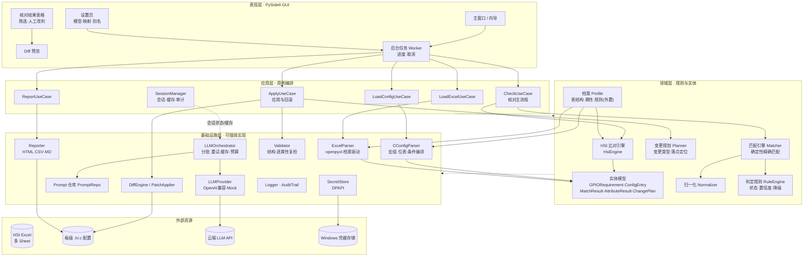
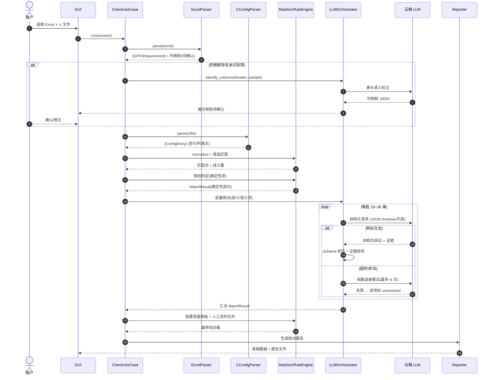
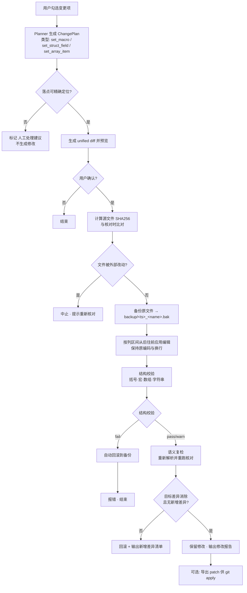
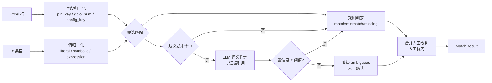
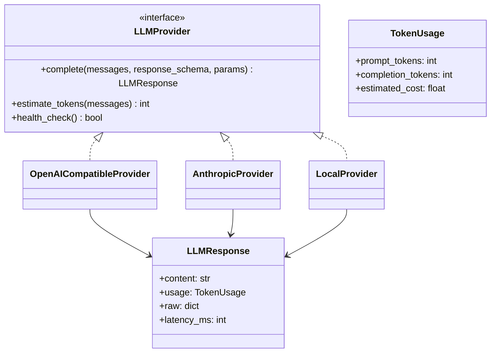
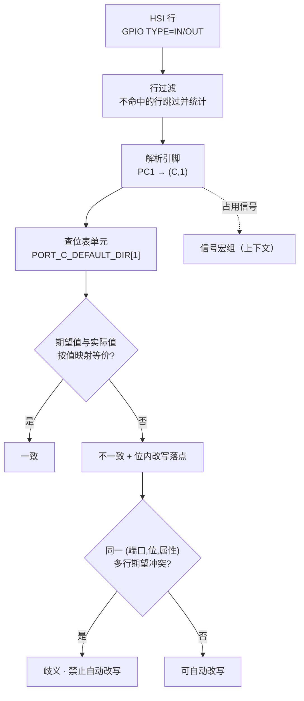

# GenBoardConfig 架构设计文档

版本：v0.1
关联文档：[requirements.md](./requirements.md)

---

## 1. 设计目标与原则

1. **LLM 只判断，不落笔**：大模型仅输出结构化结论与修改意图；所有文件写操作由确定性代码按"行 + 列区间"执行。
2. **确定性优先，LLM 兜底**：能靠精确规则判定的绝不交给 LLM；LLM 只处理语义歧义与映射。
3. **两阶段闭环**：只读核对 → 人工确认 → 应用修改 → 自动复检；任何阶段可中止。
4. **可插拔**：文件解析器、LLM 供应商、报告输出、判定规则均为接口 + 注册表，扩展不改上层。
5. **配置外置**：Prompt、列映射、别名表、判定阈值全部外置为可版本管理的文件。
6. **不破坏原文件**：写回前备份、写回后校验、失败自动回滚、文件哈希防并发覆盖。

---

## 2. 总体架构



**依赖方向**：表现层 → 应用层 → 领域层 ← 基础设施层。领域层不依赖任何具体实现，可脱网单测。

> **档案（Profile）层**是 v0.2 新增的：把「表结构 → 逐属性比对规则」从代码中抽到 `config/profiles/*.yaml`，
> 由 Excel 的 Sheet 名自动选择。通用模式（一行一配置项）与 HSI 模式（一行多属性）共用同一套基础设施。

---

## 3. 模块职责

| 模块 | 路径 | 职责 | 关键接口 |
|---|---|---|---|
| GUI | `src/genboardconfig/ui/` | 交互、表格、diff、设置、后台任务 | `MainWindow` |
| 用例层 | `src/genboardconfig/app/` | 编排流程、事务边界、进度事件 | `CheckUseCase.run(ctx)` |
| 领域模型 | `domain/models.py` | Pydantic 实体，序列化契约 | `GPIORequirement` 等 |
| 归一化 | `domain/normalize.py` | 管脚名/GPIO号/配置键统一 | `Normalizer.normalize(req)` |
| 匹配引擎 | `domain/matcher.py` | 确定性候选匹配，输出匹配对 | `Matcher.candidates(reqs, entries)` |
| 判定规则 | `domain/rules.py` | 状态判定、置信度、降级、人工覆盖 | `RuleEngine.decide(...)` |
| 变更规划 | `domain/planner.py` | 由 MatchResult 生成 ChangePlan 与落点 | `Planner.plan(results)` |
| Excel 解析 | `infra/excel/` | 表头定位、列语义映射、行归一化 | `ExcelParser.parse(path)` |
| C 解析 | `infra/cconfig/` | 词法分析、条目抽取、位置定位、文本编辑 | `CConfigParser.parse(path)` |
| LLM 适配 | `infra/llm/provider/` | 云端 API 统一封装、重试、限流、token 统计 | `LLMProvider.complete(req)` |
| LLM 编排 | `infra/llm/orchestrator.py` | 分批、Prompt 组装、结果校验、缓存、预算 | `Orchestrator.check(batch)` |
| 差异与写回 | `infra/diff/` | unified diff 生成、按位置应用、备份与回滚 | `PatchApplier.apply(plan, file)` |
| 校验 | `infra/validate/` | 结构校验、语义复检、可选 GCC 语法检查 | `Validator.validate(file)` |
| 报告 | `infra/report/` | HTML/CSV/MD 渲染 | `Reporter.render(result)` |
| 密钥 | `infra/secrets/` | DPAPI/Credential Manager 存取 | `SecretStore.get/set` |
| 配置 | `config/` | `settings.yaml`、列映射、别名表、Prompt 模板 | YAML |
| 领域知识 | `config/aliases.yaml` | 管脚别名、GPIO 编号口径、配置项同义映射 | YAML |

---

## 4. 核心流程

### 4.1 核对主流程（Check）



### 4.2 修改应用与安全闸门（Apply）



### 4.3 判定流水线



---

## 5. LLM 集成设计

### 5.1 Provider 抽象



### 5.2 Prompt 组装策略

```
SystemPrompt(vN) = 角色定义
                  + GPIO 领域知识(管脚名口径/编号口径/同义配置项)
                  + 判定规则(状态定义 + 优先级 + 置信度要求)
                  + 输出 JSON Schema
                  + 示例(2~3 条，few-shot)

UserPayload = Excel 记录块(编号.行号.字段)
             + 候选项块(ConfigEntry 摘要 + 行号 + 原文)
             + 历史已判定项(同批次, 用于消歧)
```

约束：
- 禁止在 Prompt 中出现真实密钥；对 `.c` 文本先过 `Masker`（正则 + 配置的敏感键名单）。
- 每条结论必须引用 `entry_id`，无引用的结论在后处理阶段被丢弃并转为 `unresolved`。
- Prompt 模板带版本号，写入报告与日志，保证可复现。

---

## 6. 目录结构

```
GenBoardConfig/
├─ README.md
├─ pyproject.toml
├─ config/
│  ├─ settings.yaml              # 模型、批量、阈值、路径
│  ├─ settings.local.yaml        # 本地覆盖（gitignore）
│  ├─ column_mapping.yaml        # Excel 表头 → 字段别名映射
│  ├─ aliases.yaml               # 管脚别名 / 配置项同义词 / 编号口径
│  ├─ sensitive_patterns.yaml    # 脱敏规则
│  └─ prompts/
│     ├─ identify_columns.md
│     └─ check_gpio.md
├─ docs/
│  ├─ requirements.md
│  ├─ architecture.md
│  └─ comparison_rules.md        # ← 待补：比对逻辑
├─ src/genboardconfig/
│  ├─ __main__.py                # GUI 入口
│  ├─ app/
│  │  ├─ context.py              # SessionContext / 进度事件
│  │  ├─ check_usecase.py
│  │  ├─ apply_usecase.py
│  │  ├─ report_usecase.py
│  │  └─ session_manager.py
│  ├─ domain/
│  │  ├─ models.py
│  │  ├─ normalize.py
│  │  ├─ matcher.py
│  │  ├─ rules.py
│  │  └─ planner.py
│  ├─ infra/
│  │  ├─ excel/  {reader.py, column_mapper.py}
│  │  ├─ cconfig/ {lexer.py, parser.py, editor.py, codec.py}
│  │  ├─ llm/  {provider/, orchestrator.py, prompt_repo.py, masker.py, schema.py}
│  │  ├─ diff/  {differ.py, patcher.py, backup.py}
│  │  ├─ validate/ {structure.py, semantic.py, gcc.py}
│  │  ├─ report/ {html.py, csv_export.py, templates/}
│  │  ├─ secrets/ {store.py}
│  │  └─ logging/ {logger.py, audit.py}
│  ├─ ui/
│  │  ├─ main_window.py
│  │  ├─ pages/ {check_page.py, review_page.py, settings_page.py}
│  │  ├─ widgets/ {result_table.py, diff_view.py, progress_bar.py}
│  │  └─ workers.py
│  └─ resources/ (icons, templates)
├─ tests/
│  ├─ unit/  (脱网单测)
│  ├─ fixtures/ (脱敏样例 excel/c)
│  └─ integration/ (Mock LLM)
└─ tools/
   └─ sample_gen.py              # 造脱敏测试样本
```

---

## 7. 关键设计决策（ADR 摘要）

| 编号 | 决策 | 理由 | 备选与代价 |
|---|---|---|---|
| ADR-01 | LLM 不直接改文件，只产出结构化 ChangePlan | 杜绝幻觉写入、误删代码；可审计可回滚 | 直接让模型生成整文件：实现快但风险不可控 |
| ADR-02 | 确定性匹配优先，LLM 仅处理歧义 | 成本、速度、准确率三重更优；LLM 调用量下降 60%+ | 全量交 LLM：简单但慢且贵 |
| ADR-03 | 按"行+列区间"编辑，而非按行号 | 多次修改会导致行号漂移，列区间在同文件内稳定 | 行号编辑：实现简单但易改错位置 |
| ADR-04 | 解析器注册表（Parser Registry） | 后续支持 .h/.dts/.config 时零侵入 | 硬编码单一格式：初期快但难扩展 |
| ADR-05 | 先核对后应用的两阶段 + 人工闸门 | 符合工程评审习惯；错误成本可控 | 全自动：效率高但信任成本高 |
| ADR-06 | 写回后自动语义复检 | 防止"改完引入新问题"，形成闭环 | 不复检：实现简单但失去自证能力 |
| ADR-07 | GUI 用 PySide6 | Excel/LLM/文本处理生态一致，打包为单 exe 简单 | C# WPF：原生观感好但 AI 生态割裂、双栈维护 |
| ADR-08 | Provider 抽象 + YAML 外置配置 | 国产化/多网关切换零改码 | 硬编码某家 API：初期快但受限 |
| ADR-09 | 密钥走 DPAPI / Credential Manager | 明文不落盘，符合安全基线 | 明文配置文件：部署简单但不可接受 |
| ADR-10 | `.c` 解析用轻量词法而非完整 C 前端 | 无需 GCC 环境，跨机可用，容错好 | pycparser/Clang：更精确但依赖工具链、宏难处理 |

---

## 8. 技术选型

| 层 | 选型 | 说明 |
|---|---|---|
| 语言/运行时 | Python 3.11 | 生态最全，打包方便 |
| GUI | PySide6 | 成熟桌面控件，线程模型适合长任务 |
| Excel | openpyxl | 保留格式读取、合并单元格处理 |
| 校验模型 | pydantic v2 | 结构化契约 + Schema 导出 |
| LLM 客户端 | httpx + openai SDK 兼容层 | 直控 HTTP，便于统一重试/超时/用量统计 |
| JSON Schema | jsonschema | 校验 LLM 结构化输出 |
| 差异 | difflib（标准库） | unified diff 生成 |
| 补丁 | 自研 PatchApplier | 列区间精确编辑，优于行号 |
| 编码 | charset-normalizer + 自研 codec 保持器 | GBK/UTF-8 与 CRLF/LF 保真 |
| 密钥 | keyring / DPAPI | 系统凭据库 |
| 日志 | structlog（可选） | 结构化日志 |
| 打包 | PyInstaller | 单 exe 分发 |
| 测试 | pytest + pytest-mock | 领域层脱网单测，LLM 层 Mock |

---

## 9. 部署与运行形态

```
Windows 10/11
 └─ GenBoardConfig.exe (单文件, PyInstaller)
     ├─ config/ (随包默认配置，用户目录可覆盖)
     ├─ 工作区: 用户选择 Excel/.c 所在目录
     ├─ 备份: <工作区>/.genboard/backup/<时间戳>/
     └─ 日志: <工作区>/.genboard/logs/<会话ID>.log
```

会话目录 `.genboard/` 建议加入被处理 `.c` 所在仓库的 `.gitignore`。

---

## 10. 迭代顺序建议

1. **M1**：`domain/models.py` + `infra/cconfig/lexer.py|parser.py` + `infra/excel/reader.py` + 最小 GUI（列表展示两侧条目）。
2. **M2**：`domain/normalize.py|matcher.py|rules.py` + 静态差异报告（无 LLM）。
3. **M3**：`infra/llm/*`（Provider 抽象 + Prompt + Schema + 编排）+ 核对页表格 + 证据展示。
4. **M4**：`domain/planner.py` + `infra/diff/*` + `infra/validate/*` + 备份/回滚/diff 预览。
5. **M5**：编码兼容、哈希防并发、审计日志、异常场景补齐、打包脚本。

---

## 11. 实现现状（v0.2 · 已接入真实样例）

| 规划模块 | 状态 | 落地位置 |
|---|---|---|
| 领域模型 | 已实现 | `domain/models.py`（新增 `ExpectedAttribute`/`AttributeResult`、`ConfigEntry.condition/group/role/port/bit`） |
| **档案 Profile** | **已实现** | `domain/profiles.py` + `config/profiles/hsi.yaml`（表结构·属性清单·值映射·C 侧规则） |
| 归一化 | 已实现 | `domain/normalize.py` |
| 匹配引擎 | 已实现 | `domain/matcher.py`（通用模式） |
| 判定规则 | 已实现 | `domain/rules.py`（通用模式） |
| **HSI 引擎** | **已实现** | `domain/hsi.py`（行过滤 → 引脚解析 → 端口位表逐位核对 → 冲突保护 → 落点规划） |
| 变更规划 | 已实现 | `domain/planner.py`（通用模式） |
| Excel 解析 | 已实现 | `infra/excel/reader.py`（档案驱动、表头探测、同字段多列按数据完整度取舍） |
| **C 解析** | **已实现** | `infra/cconfig/parser.py`（宏组分类、行尾注释、**条件编译多份定义**、`BitsToByte` 逐位展开 + 精确落点） |
| 精确改写 | 已实现 | `infra/cconfig/editor.py`（从后往前应用，保留编码与换行） |
| LLM Provider | 部分实现 | `openai_compatible`、`mock`；`anthropic` 预留未实现 |
| LLM 编排 | 已实现 | `infra/llm/orchestrator.py`（分批、Schema 校验、证据校验、重试、**符号语义映射**） |
| 提示词 | 已实现 | `config/prompts/{check_gpio,map_symbols,identify_columns}.md`（外置、带版本号） |
| 脱敏 | 已实现 | `infra/llm/masker.py` |
| 差异与写回 | 已实现 | `infra/diff/patcher.py`（unified diff、备份、回滚） |
| 校验 | 已实现 | `infra/validate/`（结构 + **逐属性复检**；GCC 未接） |
| 报告 | 已实现 | `infra/report/html_report.py`（HTML + CSV，档案模式按属性列渲染） |
| 密钥存储 | 已实现 | `infra/secrets/store.py`（Windows DPAPI） |
| 用例编排 | 已实现 | `app/check_usecase.py`（通用/档案双路）、`app/apply_usecase.py`、`app/report_usecase.py` |
| GUI | 已实现 | `ui/main_window.py` 等（档案自动识别、逐属性列、属性详情表） |

已实现的纵切闭环：**Excel + `.h` → 档案识别 → 行过滤 → 解析（位表逐位展开）→ 逐属性确定性核对 → 残余项模型复核 → 逐属性结论 → 勾选 → diff 预览 → 备份写回（位内改写）→ 结构校验 + 逐属性复检 → 失败回滚 → 报告导出**。

---

## 12. 档案模式的关键设计（v0.3 · 端口位表口径）

### 12.1 核对范围

| 侧 | 范围 | 配置位置 |
|---|---|---|
| C 侧 | 只核对 `PORT_<X>_DEFAULT_{OUT,DIR,PP,PU}` | `c_config.bit_tables` |
| Excel 侧 | 只核对「GPIO TYPE」列为 IN/OUT 的行 | `excel.row_filter` |
| 引脚定位 | Excel「PIN Name」列 | `excel.columns.pin_name` |
| 信号宏组 | 仅上下文（占用该引脚的信号） | `c_config.group` |

### 12.2 核对链路



### 12.3 安全约束

1. **白名单编辑**：只允许改宏右值 / 结构体字段 / 数组元素 / **端口位表单比特**（精确到列区间）。
2. **冲突保护**：同一 (位表, 端口, 位, 属性) 被多行要求且期望值冲突 → 判为歧义且不自动改写。
3. **模型置信度闸门**：复核结论需带证据且置信度 ≥ 0.7 才采纳，否则保持歧义。
4. **写回后复检**：重跑逐属性核对，确认目标差异消除且未引入新差异，失败自动回滚。

待补齐（按优先级）：① 真实云端 API 端到端验证（当前用离线 Mock）；② PWM/PSM 型引脚电平是否改取 `_POL`；
③ 多文件核对（`BoardCfg.h` + `ModelAppCfgList.h` + 实现文件）；④ 条件编译生效分支的编译命令行接入；
⑤ `Power Saving`/`Power Off` 的核对来源扩展；⑥ PyInstaller 打包脚本。

